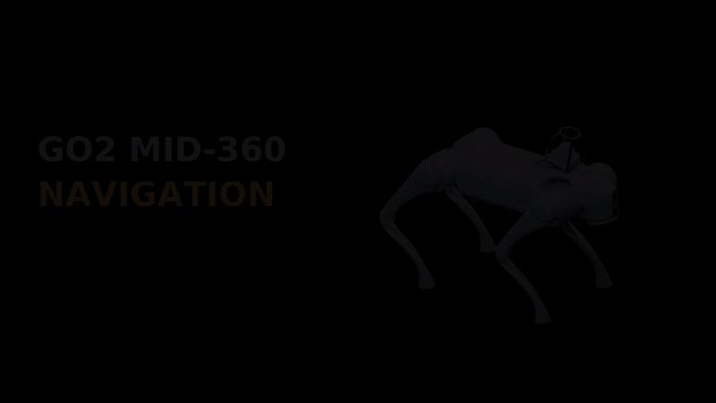
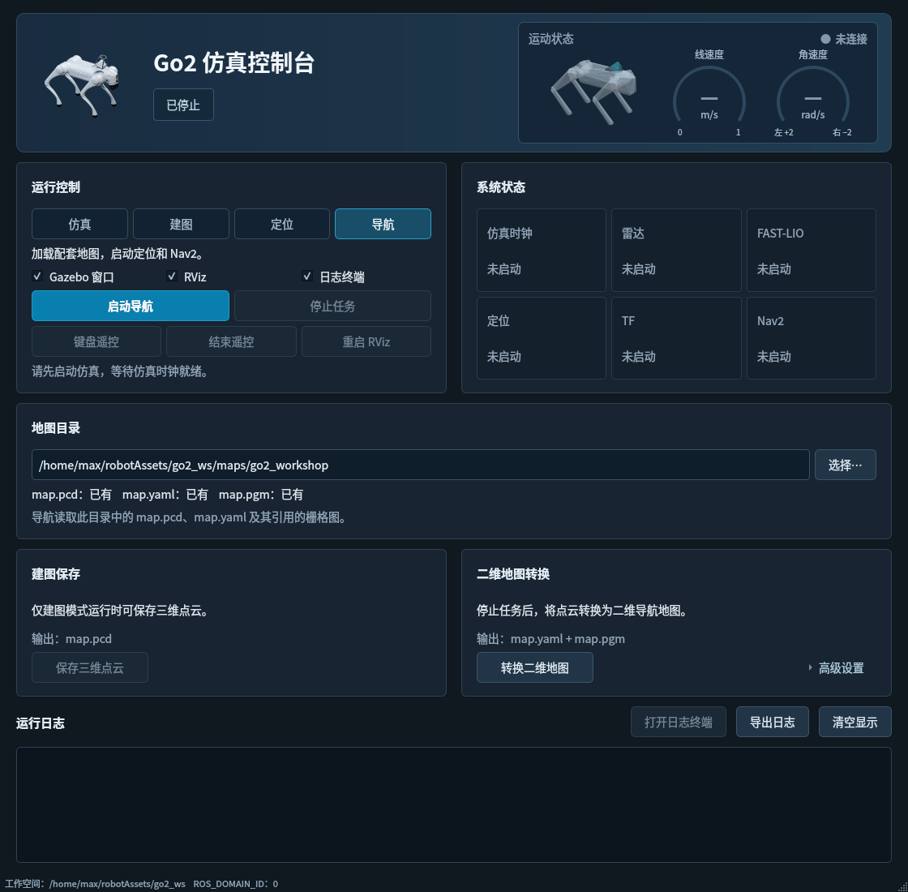

# Go2 MID-360 Navigation

**English** | [简体中文](README.zh-CN.md)

A Unitree Go2 simulation and navigation project built on ROS 2 Humble and Gazebo Classic. It integrates a MID-360 LiDAR, a D435i RGB-D camera, FAST-LIO mapping, ICP localization, and Nav2 navigation, with a desktop control panel and a furnished Go2 Workshop world with reference maps.

If you find this project useful, a star would be greatly appreciated.



[Full video](media/demo.mp4) · [Quick start](#quick-start) · [Control panel](#control-panel) · [Usage](#usage) · [Maps](#maps) · [Development](#development)

## Features

| Feature | Description |
| --- | --- |
| Robot simulation | Go2 model, CHAMP gait control, MID-360 mount, and sensor assembly |
| 3D mapping | FAST-LIO LiDAR–inertial odometry, point cloud accumulation, and PCD export |
| Global localization | ICP registration against an existing point cloud map |
| Autonomous navigation | Nav2 single-goal navigation, waypoint following, and local obstacle avoidance |
| RGB-D sensing | D435i color images, depth images, and depth point clouds |
| Desktop control | Mode selection, keyboard teleoperation, live motion display, map tools, and logs |

The default **Go2 Workshop** world contains perimeter walls, workbenches, shelves, crates, and other obstacles. Reference maps are included for localization and navigation.

## Quick start

### Requirements

| Component | Version |
| --- | --- |
| OS | Ubuntu 22.04 |
| ROS | ROS 2 Humble |
| Simulator | Gazebo Classic 11 |

### Install and build

Install ROS 2 Humble, then clone and build the project:

```bash
mkdir -p ~/go2_ws/src
cd ~/go2_ws/src
git clone https://github.com/max-niuniu/go2-mid360-navigation.git
cd ~/go2_ws
bash src/go2-mid360-navigation/scripts/setup_mid360_dependencies.bash
```

The setup script installs system dependencies, fetches pinned source revisions, applies compatibility patches, builds the workspace, and prepares the default maps. It requires network access and administrator privileges. Existing runtime maps are preserved.

**Run the commands below from the workspace root, `go2_ws/`.**

### Open the control panel

```bash
bash src/go2-mid360-navigation/scripts/run_control_panel.bash
```

## Control panel



### Start and stop

1. Select a mode in the upper-left control area: simulation, mapping, localization, or navigation, from left to right.
2. Choose whether to open Gazebo, RViz, and the log terminal, then start the selected mode.
3. Wait for the required system status indicators to become ready. Stop the current task before switching modes.

Navigation loads the included maps. Use **Nav2 Goal** in RViz to set a target position and heading.

### Teleoperation and live status

Open keyboard teleoperation from the control panel and focus its terminal. Use `W/X` to move forward or backward, `A/D` to turn, and Space to stop. End teleoperation from the panel when finished. Keyboard teleoperation is disabled during navigation.

The top display shows joint poses, motion direction, linear speed, and angular speed. The status area tracks the simulation clock, LiDAR, FAST-LIO, localization, TF, and Nav2. RViz displays color and depth images in the **D435i Color** and **D435i Depth** panels.

### Save and convert maps

1. Select an output directory in the map section, start mapping, and drive the robot through the scene.
2. Save the 3D point cloud to create `map.pcd` in that directory.
3. Stop the task, then run the 2D map conversion to generate `map.yaml` and `map.pgm`.
4. Keep the same map directory selected and start localization or navigation.

Projection height limits and map resolution are available in the conversion settings.

### RViz and logs

The RViz restart button reopens the viewer without stopping the simulation. Logs can be viewed, exported, or cleared in the panel; the log terminal provides the full output. See the [control panel guide](go2_mid360_panel/README.md) for details.

## Usage

Run one mode at a time. The scripts load the ROS environment automatically. Press `Ctrl+C` to stop.

### 1. Simulation and teleoperation

```bash
bash src/go2-mid360-navigation/scripts/run_mid360_sim.bash gui:=true rviz:=true
```

Open keyboard teleoperation from the control panel, or run it in another terminal:

```bash
bash src/go2-mid360-navigation/scripts/run_teleop.bash
```

| Key | Action |
| --- | --- |
| `W` / `X` | Forward / backward |
| `A` / `D` | Turn left / right in place |
| `Q` / `E` / `Z` / `C` | Move and turn |
| `Shift` + movement key | Translate without turning |
| `S` / Space | Stop |
| `R` / `F` | Increase / decrease both speeds |
| `T` / `G` | Increase / decrease linear speed |
| `Y` / `H` | Increase / decrease angular speed |

Default speeds are **0.5 m/s** and **1.0 rad/s**. Each adjustment changes the speed by 10%. Hold a movement key to keep moving; after release, the controller stops on a 0.5-second command timeout. Navigation and keyboard teleoperation are mutually exclusive.

### 2. 3D mapping

Create a separate directory for a new map:

```bash
mkdir -p maps/my_scene
bash src/go2-mid360-navigation/scripts/run_fast_lio_3d_mapping.bash \
  gui:=true show_rviz:=true map_output:="$PWD/maps/my_scene/map.pcd"
```

Once initialization finishes, drive the robot through the scene and observe the point cloud in RViz. Save the map from the control panel, or use another terminal:

```bash
source src/go2-mid360-navigation/scripts/setup_env.bash
ros2 service call /map_save std_srvs/srv/Trigger '{}'
```

A normal `Ctrl+C` shutdown also saves the point cloud. Without `map_output`, mapping writes to `maps/go2_workshop/map.pcd` and overwrites an existing file.

### 3. Point cloud localization

```bash
bash src/go2-mid360-navigation/scripts/run_fast_lio_3d_localization.bash \
  gui:=true show_rviz:=true
```

This mode combines FAST-LIO odometry with ICP registration against an existing 3D map. It does not start Nav2. Drive the robot and check the alignment between live scans and the reference map in RViz.

### 4. Autonomous navigation

```bash
bash src/go2-mid360-navigation/scripts/run_navigation.bash \
  gui:=true show_rviz:=true
```

Startup sequence: **simulation and localization → TF ready → Nav2 active → RViz**.

- **Single goal:** set a position and heading with **Nav2 Goal** in RViz.
- **Waypoints:** add goals in waypoint mode through the Nav2 panel, then start the sequence.
- **Manual initialization:** pass `auto_initial_pose:=false` and set the initial pose with **2D Pose Estimate**.

The default configuration uses the Go2 Workshop maps and initializes localization at `(x=0, y=0, yaw=0)` in the map frame.

## Maps

| Location | Purpose |
| --- | --- |
| `go2_mid360_bringup/maps/go2_workshop/` | Reference maps distributed with the repository |
| `go2_ws/maps/go2_workshop/` | Default runtime maps |
| `go2_ws/maps/<scene_name>/` | User maps and mapping output |

A map set contains `map.pcd` for 3D localization and `map.yaml` plus `map.pgm` for 2D navigation. See [Go2 Workshop](go2_mid360_sim/worlds/README.md) for scene details.

### View point clouds and create 2D maps

View the default point cloud map:

```bash
bash src/go2-mid360-navigation/scripts/view_mid360_3d_map.bash
```

After stopping the simulation, select the map directory in the control panel and run the 2D conversion, or use:

```bash
source src/go2-mid360-navigation/scripts/setup_env.bash
ros2 run go2_fastlio_localization pcd_to_nav2_map \
  "$PWD/maps/my_scene/map.pcd" "$PWD/maps/my_scene/map" \
  --resolution 0.05 --z-min 0.35 --z-max 2.60 \
  --padding 0.30 --min-points 2 --dilation-cells 1
```

Height limits refer to the Z axis of the PCD frame. Conversion overwrites existing 2D maps, including manual edits. Restart navigation after updating a map.

### Custom scenes

Navigation accepts `world`, `pcd_map`, `nav_map`, `initial_x`, `initial_y`, and `initial_yaw`. Use matching world, point cloud, and occupancy maps. Initial localization poses are expressed in the map frame.

```bash
bash src/go2-mid360-navigation/scripts/run_navigation.bash \
  world:=/absolute/path/scene.world \
  pcd_map:="$PWD/maps/my_scene/map.pcd" \
  nav_map:="$PWD/maps/my_scene/map.yaml"
```

## Development

### Workspace layout

```text
go2_ws/
├── src/
│   ├── go2-mid360-navigation/
│   │   ├── go2_*/              ROS packages
│   │   ├── scripts/            Setup, build, and launch scripts
│   │   ├── patches/            Third-party patches
│   │   ├── media/              Demo videos and screenshots
│   │   └── dependencies.repos  Dependency sources and pinned revisions
│   └── third_party/            Third-party source code
├── maps/                       Runtime maps and mapping output
├── build/
├── install/
└── log/
```

| Package | Responsibility |
| --- | --- |
| `go2_mid360_description` | Robot and sensor models, mounting transforms |
| `go2_mid360_config` | Gait, joint control, and communication settings |
| `go2_mid360_sim` | Gazebo, sensor simulation, and worlds |
| `go2_fastlio_localization` | Mapping, ICP localization, odometry bridging, and map conversion |
| `go2_mid360_bringup` | System launch files, Nav2, reference maps, and RViz configuration |
| `go2_mid360_panel` | Desktop control panel and status display |

### Build and dependencies

Rebuild the workspace:

```bash
bash src/go2-mid360-navigation/scripts/build.bash
source src/go2-mid360-navigation/scripts/setup_env.bash
```

Rebuild a single package:

```bash
source src/go2-mid360-navigation/scripts/setup_env.bash
colcon build --symlink-install --packages-select go2_fastlio_localization
source src/go2-mid360-navigation/scripts/setup_env.bash
```

Dependency revisions are pinned in [dependencies.repos](dependencies.repos); compatibility changes are stored in [patches/](patches/). `prepare_sources.bash` fetches sources and applies patches. `apply_compatibility.bash` validates existing sources and applies patches. Both scripts can be rerun; version mismatches or patch conflicts stop the operation without replacing existing source trees.

### ROS launch commands

Before running ROS commands directly, load the environment in each new terminal with `source src/go2-mid360-navigation/scripts/setup_env.bash`.

| Mode | Command |
| --- | --- |
| Simulation | `ros2 launch go2_mid360_sim simulation.launch.py gui:=true rviz:=true` |
| Mapping | `ros2 launch go2_mid360_bringup mapping.launch.py gui:=true show_rviz:=true` |
| Localization | `ros2 launch go2_mid360_bringup localization.launch.py gui:=true show_rviz:=true` |
| Navigation | `ros2 launch go2_mid360_bringup navigation.launch.py gui:=true show_rviz:=true` |
| Point cloud viewer | `ros2 launch go2_mid360_bringup view_3d_map.launch.py` |

### Configuration

| Setting | File |
| --- | --- |
| MID-360 mounting pose | [mid360_mount.yaml](go2_mid360_description/config/mid360_mount.yaml) · [Mount model](go2_mid360_description/meshes/mid360_mount/README.md) |
| D435i enable switch, mounting pose, and image settings | [d435i.yaml](go2_mid360_description/config/d435i.yaml) |
| Gazebo | [gazebo.yaml](go2_mid360_sim/config/gazebo.yaml) |
| Joint controllers | [ros_control.yaml](go2_mid360_config/config/ros_control/ros_control.yaml) |
| FAST-LIO | [fast_lio_mid360_sim.yaml](go2_fastlio_localization/config/fast_lio_mid360_sim.yaml) |
| Nav2 | [fast_lio_nav2.yaml](go2_mid360_bringup/config/autonomy/fast_lio_nav2.yaml) |

### Topics and frames

```text
map → odom → base_footprint → base_link → mid360_mount_link → mid360_link
```

| Topic | Data |
| --- | --- |
| `/livox/lidar` | `PointCloud2` point cloud |
| `/livox/lidar_custom` | Livox `CustomMsg` point cloud |
| `/imu/data` | IMU data |
| `/Odometry` | FAST-LIO odometry |
| `/odom` | Navigation odometry |
| `/scan` | 2D laser scan |
| `/camera/color/image_raw` | D435i color image; default 640 × 360 at 15 Hz |
| `/camera/depth/image_raw` | D435i depth image; default 640 × 360 at 15 Hz |
| `/camera/color/camera_info` | Color camera parameters |
| `/camera/depth/camera_info` | Depth camera parameters |
| `/camera/depth/points` | Depth point cloud, generated when subscribed |

`/odom` is derived from FAST-LIO odometry. ICP provides global localization, and Nav2 uses the occupancy map and `/scan` for planning and obstacle avoidance. The control panel displays Gazebo ground-truth velocity; navigation localization does not use ground-truth odometry.

## Troubleshooting

| Issue | Action |
| --- | --- |
| Gazebo port already in use | Press `Ctrl+C` in the previous launch terminal and wait for `gzserver` to exit |
| Package not found in a new terminal | Source `scripts/setup_env.bash` again |
| RViz is unresponsive | Restart RViz from the panel; dependency setup includes the tf2 0.25.24 deadlock fix |
| Map changes are not visible | Restart navigation to reload the map |
| RViz shows Localization inactive | This project uses ICP; check scan alignment, `ICP accepted` logs, and the `map → base_footprint` transform |

## Dependencies and licensing

Original contributions to this project are licensed under [BSD-3-Clause](LICENSE). Third-party code, models, and patches retain their respective licenses: [dependency revisions](dependencies.repos) · [patches](patches/LICENSE) · [Go2 models](go2_mid360_description/meshes/LICENSE) · [D435i model](go2_mid360_description/meshes/d435i/LICENSE).

## Team

- **Maintainer:** [Tianwei Niu](mailto:tianwei.niu@cau.edu.cn)
- **Supervisors:** Man Zhang and Han Li
